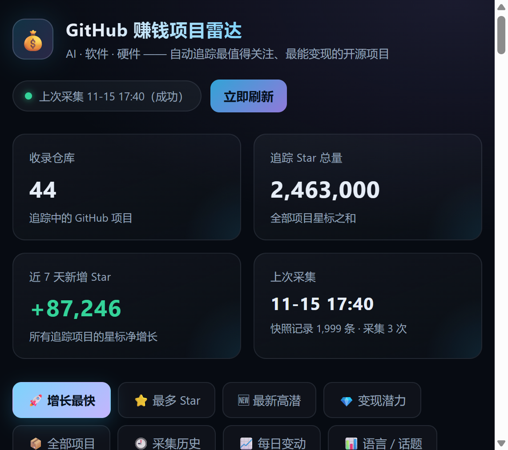
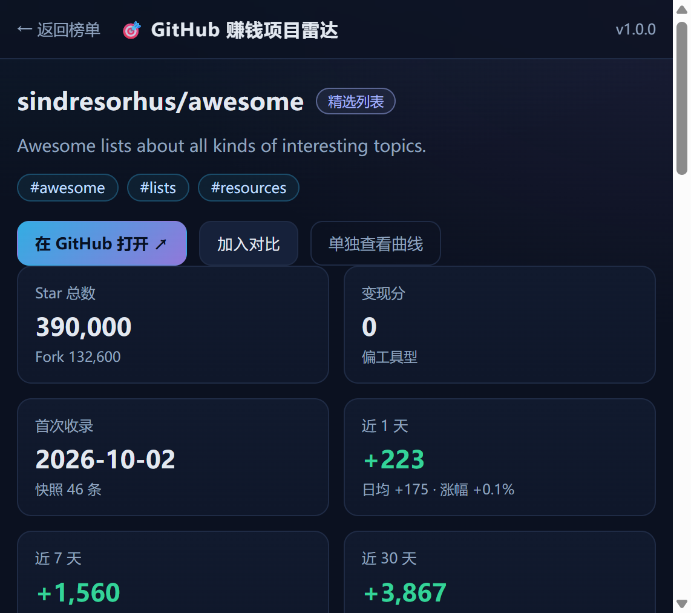
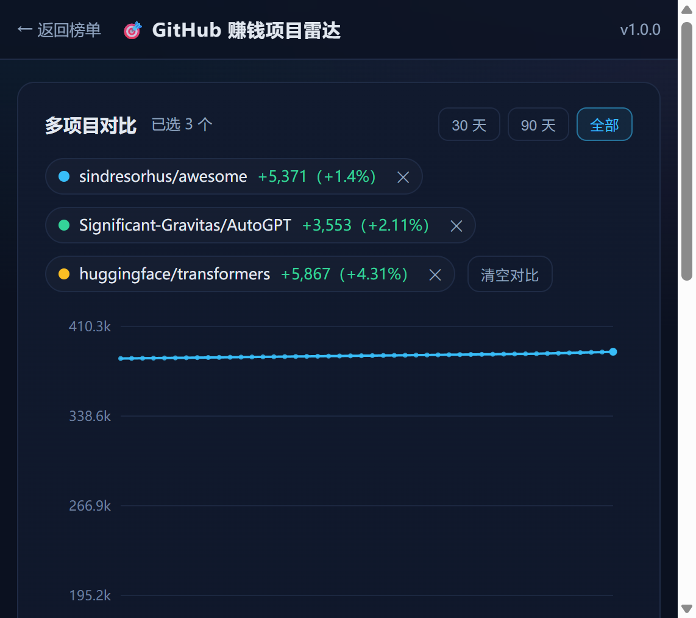

# GitHub Money Hunter

[中文](README.md) | **English**

[](https://www.python.org/)
[](LICENSE)
[](tests/)

An open-source project-tracking tool written in Python: it periodically collects
GitHub projects across **AI / software / hardware / e-commerce / quant / automation**,
records Star snapshots, and surfaces:

- 🚀 **Fastest growing** — projects with the biggest Star gain in a window (switch between total growth / avg per day)
- ⭐ **Most stars** — large projects with proven traction
- 🆕 **New high-potential** — recently created projects gaining stars fast
- 💎 **Monetization potential** — ranked by keyword-based "can you make money with it" score (SaaS, e-commerce, marketing, trading, automation, …)

All data is stored in a local SQLite database, with a dark-themed web dashboard,
terminal leaderboards, and Markdown / HTML reports.



Project detail page and multi-project comparison:

| Project detail (history) | Multi-project comparison |
|---|---|
|  |  |

---

## Features

| Feature | Description |
|---|---|
| Auto collection | Calls the GitHub Search API by configured queries, de-duplicates, writes to DB |
| Existing repo refresh | After each run, batch-refreshes Stars of all tracked repos via GraphQL (REST fallback without token) |
| Star snapshots | Records Star / Fork each run, used to compute real growth |
| Growth leaderboard | Net growth and avg per day within a window, with mini trend charts |
| New project leaderboard | Projects created within the last N days, ranked by "avg stars per day" |
| Monetization score | Heuristic keyword scoring (0–100) on name / description / topics |
| Quality filtering | Detects awesome lists, suspected star-farming, stale repos; filters + flags |
| Project detail | Star history curve, multi-window growth, info, one-click add to compare |
| Multi-project compare | Up to 6 projects on one chart, absolute / relative growth, range filter |
| Daily digest | Growth top, star spikes, new high-potential, pushed to ServerChan / Feishu / DingTalk / Telegram / email |
| Web dashboard | Dark theme, search, leaderboards, CSV export, 60s auto-refresh, daily changes / language-topic breakdown |
| Production deploy | waitress server, optional access password (HTTP Basic), daily log rotation, Docker Compose |
| Scheduled updates | Built-in `watch` loop, or Windows Task Scheduler / cron |
| Report export | Markdown + HTML, easy to share or archive |
| Demo data | `demo` command generates synthetic data to preview the UI instantly |

---

## Project Optimizations & Technical Highlights

Beyond core features, this project includes several engineering optimizations for long-term operation on a personal server or LAN:

- **Production-grade web server**: Uses [waitress](https://docs.pylonsproject.org/projects/waitress/) instead of Flask's built-in development server, with multi-threaded concurrency suitable for LAN or server environments. Falls back gracefully if waitress is not installed.
- **Optional access password**: Supports HTTP Basic Auth (`web.auth_user` / `web.auth_password`); all pages and APIs require login by default. `/health` is always unauthenticated for Docker health probes.
- **Log rotation**: All commands write logs to `data/logs/money_hunter.log` using `TimedRotatingFileHandler` with daily rotation, keeping 7 days by default (configurable via `web.log_backup_days`), preventing unbounded log file growth.
- **Robust growth calculation**: Computes real growth based on local SQLite Star snapshots rather than relying on GitHub's live API. Supports batch refresh of existing repos (GraphQL with token, REST fallback without token with limited count to protect core API quota).
- **Frontend experience**: Dark-themed dashboard, multiple leaderboards (growth / stars / new projects / monetization / all / collection history / daily changes / language-topic breakdown), search filter, CSV export, 60s auto-refresh, multi-project comparison (up to 6 projects, selections persisted in browser localStorage).
- **Testing & maintainability**: 51 unit tests covering collector, notification channels, web endpoints, access auth, and log rotation. Configuration and environment variables are separated; GitHub token and web password are recommended to be injected via environment variables, not hardcoded.
- **Docker one-click deployment**: Provides `Dockerfile` + `docker-compose.yml`; container runs as non-root user, includes a healthcheck (30s probe on `/health`), and database/logs are persisted to host `./data` via volumes.

---

## Quick Start

Requirements: Python 3.10+ (developed on Python 3.13).

```bash
# 1. Install dependencies
pip install -r requirements.txt

# 2. (Recommended) Configure a GitHub token for higher API quota
#    Linux / macOS:
export GITHUB_TOKEN=ghp_xxxxxxxxxxxxxxxx
#    Windows PowerShell:
$env:GITHUB_TOKEN = "ghp_xxxxxxxxxxxxxxxx"

# 3. Collect data once (~1–3 min, depending on the number of queries)
python run.py collect

# 4. Start the web dashboard
python run.py web
# The browser opens http://127.0.0.1:8000 automatically
```

Don't want to wait for collection? Preview with demo data:

```bash
python run.py demo          # generate demo data and start the dashboard
```

> On first run, `config.example.yaml` is copied to `config.yaml`. You can edit search keywords there.

### About GitHub Token

It works without a token, but the GitHub search API limits unauthenticated
requests to **~10/min**, so collection is slow. Create a **no-permission (classic)**
token at <https://github.com/settings/tokens> — authenticated search allows
**30/min**, plenty for daily use.

Recommended to keep the token in the `GITHUB_TOKEN` environment variable, not in files:

- Windows: `setx GITHUB_TOKEN "ghp_xxx"` (takes effect in a new terminal)
- macOS / Linux: add to `~/.bashrc` / `~/.zshrc`

---

## Commands

```bash
python run.py collect              # collect once
python run.py collect --max-queries 3 --no-new   # debug: only 3 queries, skip new-project search
python run.py watch                # scheduled collection (default every 360 min, configurable)
python run.py watch --interval 60  # collect every 60 minutes
python run.py top                  # view the four leaderboards in the terminal
python run.py top --limit 20       # show 20 items per leaderboard
python run.py report               # export Markdown / HTML to reports/
python run.py digest --dry-run     # preview the daily digest (no push)
python run.py digest               # build and push the digest (requires notify config)
python run.py collect --notify     # push the digest after collecting
python run.py web                  # start the web dashboard (--port 8080 to change port)
python run.py demo                 # start the dashboard with demo data (--seed-only generates data only)
python run.py stats                # view database statistics
python run.py init                 # create the config file only
```

Global options: `--config custom-config-path`, `--db custom-db-path`.

---

## Configuration (config.yaml)

| Config | Default | Description |
|---|---|---|
| `token` | empty | GitHub Token; `GITHUB_TOKEN` env var takes priority |
| `db_path` | `data/money_hunter.db` | SQLite DB path (relative to project root) |
| `min_stars` | `50` | Ignore repos with fewer stars than this |
| `per_query` | `50` | Items to fetch per query (1–100) |
| `request_delay` | null | Seconds between requests; `null` means auto (7s without token, 2s with token) |
| `interval_minutes` | `360` | `watch` mode default collection interval (minutes) |
| `growth_window_days` | `7` | Growth leaderboard default window (days) |
| `new_within_days` | `60` | New-project leaderboard "created within N days" |
| `top_limit` | `50` | Default items shown per leaderboard |
| `refresh_existing` | `true` | Batch-refresh tracked repo stars after each collection |
| `refresh_limit` | `2000` | Max repos refreshed per run with token (GraphQL) |
| `refresh_limit_no_token` | `30` | Max repos refreshed per run without token (REST) |
| `refresh_batch_size` | `100` | GraphQL batch size (1–100) |
| `inactive_days` | `180` | Repos with no push for N days marked "stale" |
| `suspect_daily_stars` | `250` | Daily star gain above this + low fork/star → suspected farming |
| `suspect_fork_ratio` | `0.01` | Suspected farming fork/star ratio upper bound |
| `queries` | see template | Full collection queries (GitHub search syntax) |
| `new_queries` | see template | New-project queries; `{since}` is replaced with date |

To follow another direction, just edit `queries`, e.g.:

```yaml
queries:
  - "topic:ai-agents stars:>1000"
  - "keyword:indie-hacker stars:>100"
  - "topic:chrome-extension stars:>1000"
  - "topic:serverless stars:>2000"
```

---

## Scheduled Updates

### Method 1: built-in `watch` (simplest)

```bash
python run.py watch --interval 180
```

Keep the terminal open; it collects every 180 minutes. Press `Ctrl+C` to stop.

### Method 2: Windows Task Scheduler

1. Open "Task Scheduler" → "Create Basic Task"
2. Trigger: "Daily", set repeat interval as needed
3. Action: "Start a program"
   - Program: `python.exe` (or full path like `C:\Python313\python.exe`)
   - Arguments: `run.py collect`
   - Start in: your actual project absolute path (e.g. `C:\Users\YourName\项目搜集`)

You can also double-click `立即采集.bat` in the project to verify the command.

### Method 3: Linux / macOS cron

```cron
# Collect every 6 hours (replace /path/to/项目搜集 with your actual absolute path)
0 */6 * * * cd /path/to/项目搜集 && /usr/bin/python3 run.py collect >> data/cron.log 2>&1
```

---

## Daily Digest (optional)

After configuring `config.yaml`'s `notify` section, there are three trigger modes:

```bash
python run.py digest              # build and push once
python run.py collect --notify    # push after collecting
python run.py watch               # push automatically after each successful collection
```

Digest content includes: collection overview, growth top 5, star spikes (daily ≥ `spike_threshold`), new high-potential projects.

Common channel configs:

```yaml
# ServerChan (WeChat push, simplest): get SendKey at https://sct.ftqq.com
notify:
  type: serverchan
  webhook: "SCTxxxxxxxx"

# Feishu group bot
notify:
  type: feishu
  webhook: "https://open.feishu.cn/open-apis/bot/v2/hook/xxxx"

# DingTalk group bot
notify:
  type: dingtalk
  webhook: "https://oapi.dingtalk.com/robot/send?access_token=xxxx"

# Telegram: webhook is the bot token, chat_id is the chat ID
notify:
  type: telegram
  webhook: "123456:ABC-DEF..."
  chat_id: "123456789"

# Email
notify:
  type: email
  smtp_host: "smtp.qq.com"
  smtp_port: 465
  smtp_user: "you@qq.com"
  smtp_password: "authorization-code"
  to: "you@qq.com"
```

To push daily at 9 AM, schedule `python run.py digest` via Windows Task Scheduler / cron; no need to run `watch` persistently.

---

## Project Detail & Multi-Project Comparison

- Click a project name on a leaderboard to open `/repo/<id>`: Star history curve (7 / 30 / 90 days / all-time), multi-window growth, total growth, monetization score, topics & basic info
- Each row has an "Add to compare" button (max 6); a compare bar appears at the bottom
- Comparison page `/compare?ids=1,2,3`: multi-line chart, absolute / relative growth (start = 100) toggle, range filter, growth table
- Compare selections are saved in browser localStorage and persist across page changes; "Clear compare" resets them

---

## How Metrics Are Calculated

- **Growth**: current Star − baseline Star (the latest snapshot N days ago at the start of the window). If a repo is first tracked inside the window, its earliest snapshot is the baseline, so this is "observed growth during tracking".
- **Avg per day**: growth ÷ observed days. Shows "—" if observation is less than 1 day, to avoid exaggeration by extrapolating to days.
- **Stars/day (new projects)**: current Star ÷ project age in days.
- **Monetization score**: weighted keyword scoring on name / description / topics, e.g. `saas`, `boilerplate`, `stripe`, `ecommerce`, `affiliate`, `trading`, `automation`, `crm`, `newsletter`, `esp32`, etc. Upper bound 100. Pure heuristic, for reference only.

### Existing Repo Refresh & Quality Filtering

- **Existing repo refresh**: search only updates a repo when it matches a keyword, causing "dropped repos don't update stars". After each collection, we batch-refresh stars of all repos in DB:
  - With `GITHUB_TOKEN`: uses **GraphQL**, queries 100 repos per call, can cover thousands of existing repos
  - Without token: falls back to REST single queries, refreshes only the top 30 starred repos (core quota is only 60/hour)
- **Quality flags** (recomputed each run):
  - `awesome list`: `awesome-*`, topic contains `awesome`, description is a curated list
  - `stale`: no push for more than `inactive_days` (default 180 days)
  - `suspected farming`: daily star gain ≥ `suspect_daily_stars` (default 250) and fork/star ≤ `suspect_fork_ratio` (default 0.01)
- Growth / New / Monetization leaderboards **exclude** awesome lists and archived repos by default; Growth and New leaderboards also exclude stale repos. UI still shows badge hints.

> The growth leaderboard needs at least two collections at different times to show data — this is normal.

---

## Data Storage

Three SQLite tables:

- `repos`: repo basic info + latest star + monetization score + quality flags (`is_awesome` / `is_inactive` / `star_suspect`)
- `snapshots`: star / fork snapshot per collection (the basis for growth calculation); `source` distinguishes "search result" vs "existing repo refresh"
- `runs`: each collection run record (successful query count, new repos count, refreshed count, error info)

Older DBs auto-add missing columns (`ALTER TABLE`) on startup — no manual migration. Open `data/money_hunter.db` with any SQLite tool to query.

---

## Directory Structure

```
项目搜集/
├── run.py                     # CLI entry point
├── config.example.yaml        # config template (copied to config.yaml on first run)
├── requirements.txt
├── moneyhunter/
│   ├── config.py              # config loading
│   ├── db.py                  # SQLite data layer
│   ├── github_api.py          # GitHub API client (REST search + GraphQL batch refresh)
│   ├── collector.py           # collector (with existing-repo refresh)
│   ├── quality.py             # quality flagging (awesome / farming / stale)
│   ├── scoring.py             # monetization scoring
│   ├── analytics.py           # leaderboard calc + detail / compare data
│   ├── reports.py             # terminal / Markdown / HTML reports
│   ├── notifier.py            # digest generation & multi-channel push
│   ├── web.py                 # Flask dashboard + detail / compare pages
│   ├── demo.py                # demo data
│   ├── templates/
│   │   ├── dashboard.html     # dashboard
│   │   ├── detail.html        # project detail (history chart)
│   │   ├── compare.html       # multi-project compare
│   │   └── not_found.html
│   └── static/
│       ├── base.css           # detail / compare styles
│       └── chart.js           # lightweight SVG line chart (no external deps)
├── tests/                     # unit tests
├── data/                      # database (auto-created)
├── reports/                   # exported reports
└── docs/
    └── images/                # UI screenshots (added for open-source release, referenced by README)
```

---

## Running Tests

```bash
python -m unittest discover -s tests -v
```

---

## Production Deployment (P2 Engineering)

### 1. Built-in production server (waitress)

`python run.py web` uses [waitress](https://docs.pylonsproject.org/projects/waitress/) by default (already in `requirements.txt`).
If waitress isn't installed, it falls back to Flask's dev server and warns you; install waitress for production:

```bash
pip install -r requirements.txt
```

### 2. Access password (HTTP Basic Auth)

In `config.yaml`:

```yaml
web:
  auth_user: "admin"
  auth_password: "change-me"
```

Or via environment variables (higher priority, suitable for Docker / CI):

```bash
export GHMH_WEB_USER=admin
export GHMH_WEB_PASSWORD=your-password
# Windows PowerShell: $env:GHMH_WEB_USER="admin"; or write to .env
```

After enabling, all pages and APIs require login (browser shows a Basic Auth dialog);
`/health` is always unauthenticated for container health probes.

### 3. Log rotation

All commands write logs to `data/logs/money_hunter.log`, rotated daily at midnight, keeping 7 days by default;
adjust with `web.log_backup_days`. WARNING and above also go to console.

### 4. Docker deployment (recommended)

```bash
# 1) Prepare env vars (at least GITHUB_TOKEN; recommended to also set web password)
export GITHUB_TOKEN=ghp_xxx
export GHMH_WEB_USER=admin
export GHMH_WEB_PASSWORD=your-password
#    Windows PowerShell: $env:GITHUB_TOKEN="ghp_xxx" ... (or write to .env)

# 2) Build and start in background
docker compose up -d --build

# 3) Open browser at http://localhost:8000 (login dialog if password set)

# 4) First use: run one collection inside the container (results land on mounted ./data)
docker compose exec money-hunter python run.py collect

# 5) View logs / stop
docker compose logs -f
docker compose down
```

- DB and logs persist on the host at `./data` (`data/logs/` rotated daily);
- compose auto-reads the project-root `.env` file (`GITHUB_TOKEN` / `GHMH_WEB_USER` / `GHMH_WEB_PASSWORD`);
- container runs as non-root user, built-in healthcheck (30s probe on `/health`);
- to mount a custom `config.yaml`, uncomment the corresponding line in `docker-compose.yml` (only if the file already exists on the host).

---

## FAQ

**1. Error 403 / rate limited?**  
Unauthenticated search is ~10/min. Set `GITHUB_TOKEN` env var and restart; the program auto-waits and retries on rate limit.

**2. Growth leaderboard empty?**  
Needs two collections at different times. Run `collect`, wait a few hours (or until tomorrow), then `collect` again.

**3. Collection is slow?**  
Many queries + no token means 7s between requests. Reduce `queries`, configure a token, or use `--max-queries` to debug.

**4. Why only 30 repos refreshed?**  
Without `GITHUB_TOKEN`, GraphQL is unavailable, so we fall back to the REST core endpoint (60/hour), refreshing only the top 30 starred repos by default. With a token we use GraphQL and can cover `refresh_limit` repos (default 2000).

**5. A repo flagged "suspected farming"?**  
This is a heuristic (daily star gain ≥ `suspect_daily_stars` AND fork/star ≤ `suspect_fork_ratio`), possible false positive. Raise the threshold in `config.yaml` or ignore the badge.

**6. Change port / access from LAN?**  
`python run.py web --port 8080`; for LAN access add `--host 0.0.0.0`.

**7. Push not received?**  
First `python run.py digest --dry-run` to see if content generates; then check `notify.type` / `notify.webhook` (ServerChan is SendKey, Feishu/DingTalk is full webhook URL, Telegram is bot token + chat_id). Push failures don't affect collection; terminal shows the failure reason.

**8. Auto-push daily at 9 AM?**  
Schedule `python run.py digest` via Windows Task Scheduler / cron; no need to run `watch` persistently.

**9. Is demo data real?**  
No. `demo` generates synthetic data only for UI preview.

---

## Disclaimer

This project is for technical learning and project discovery only, and does not constitute investment advice.
Monetization score is a keyword heuristic estimate and does not represent true commercial value;
please evaluate open-source licenses and compliance risks yourself.

---

## Open Source & Contribution

This project is open-sourced under the [MIT License](LICENSE). Stars, Issues, and PRs are welcome.

**Local development & testing**

```bash
pip install -r requirements.txt
python -m unittest discover -s tests -v
```

**Contribution flow**

1. Fork this repo and create a branch: `git checkout -b feature/your-feature`
2. Modify code, add or update unit tests in `tests/`
3. Make sure `python -m unittest discover -s tests` fully passes
4. Submit a PR describing the motivation and how you tested

**Pre-release checklist**

- [ ] Confirm `config.yaml`, `.env`, `data/`, `reports/` are NOT committed (already ignored by `.gitignore`)
- [ ] No GitHub tokens, passwords, or personal absolute paths in the repo
- [ ] Screenshots are under `docs/images/` and referenced in README
- [ ] Repo "About" filled with description and topics (e.g. `github-api`, `data-visualization`, `flask`, `sqlite`, `open-source-tracking`)
- [ ] Add `LICENSE` (this repo defaults to MIT)

**Regenerate README screenshots (optional)**

```bash
python run.py demo --seed-only            # generate demo data
python run.py --db data/demo.db web --port 8021
# Open http://127.0.0.1:8021 in browser, screenshot dashboard / detail / compare, save to docs/images/
```

**Chinese version**: [README.md](README.md)
