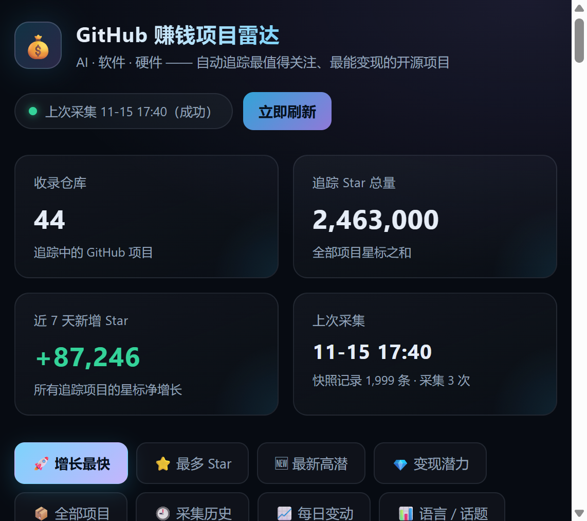
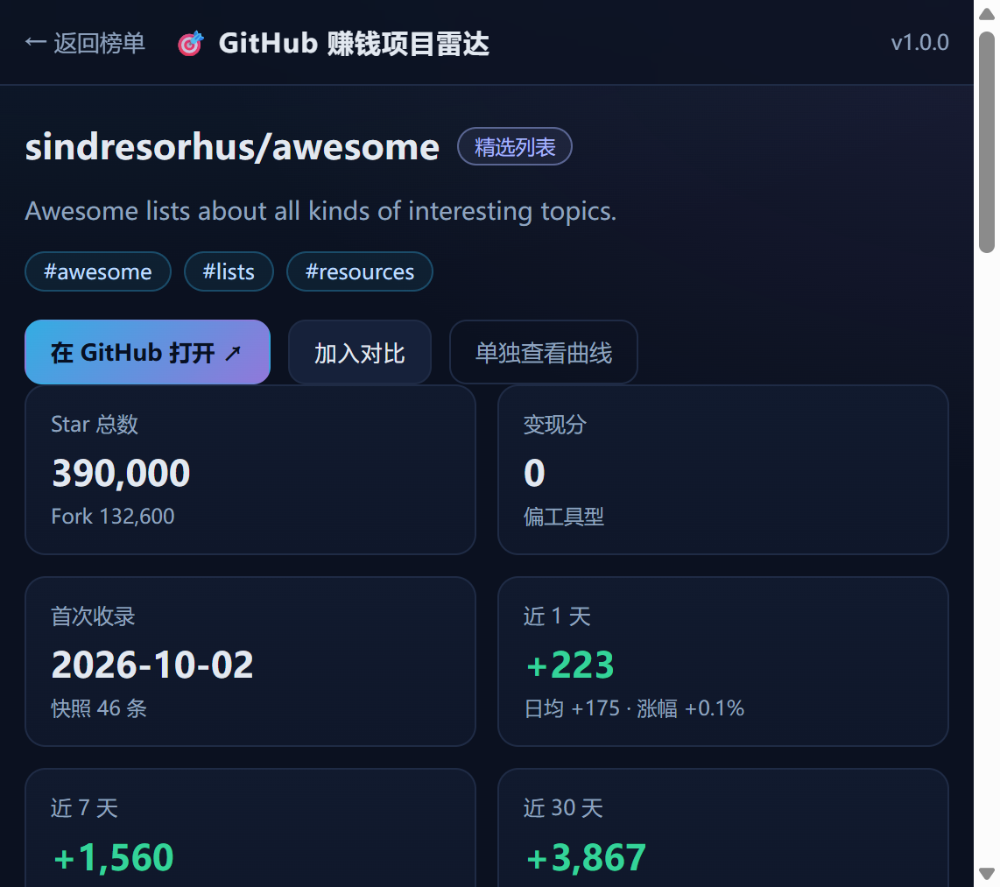
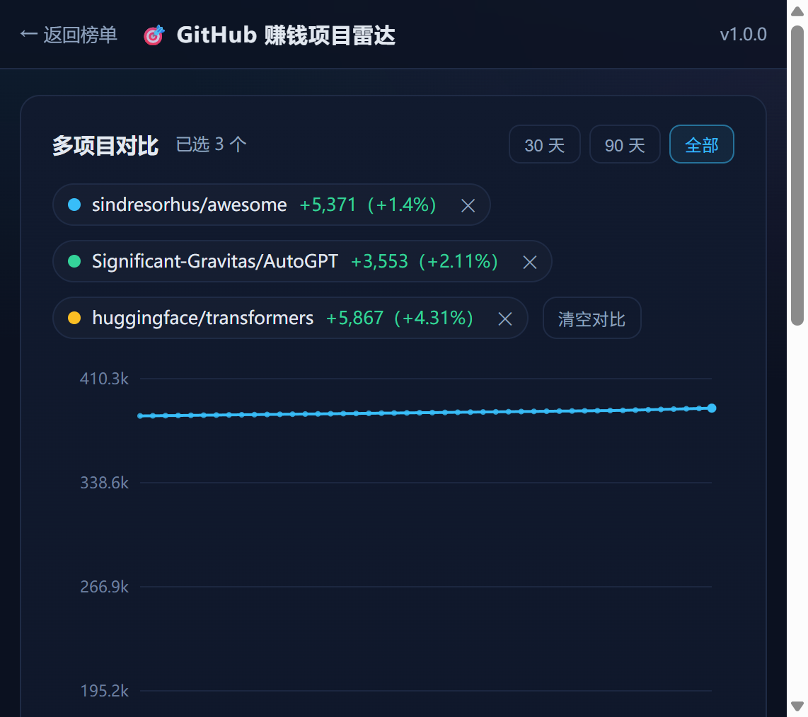

# GitHub 赚钱项目雷达（GitHub Money Hunter）

[English](README.en.md)

[](https://www.python.org/)
[](LICENSE)
[](tests/)

一个用 Python 写的开源项目追踪工具：定期从 GitHub 搜集 **AI / 软件 / 硬件 / 电商 / 量化 / 自动化** 等领域的项目，
自动记录 Star 快照，帮你找出：

- 🚀 **增长最快** —— 统计窗口内 Star 涨得最多的项目（可切换“按总增长 / 按日均增速”）
- ⭐ **Star 最多** —— 已经验证过热度的大项目
- 🆕 **最新高潜** —— 最近 N 天创建、星标飞涨的新项目
- 💎 **变现潜力** —— 按“能不能靠它赚钱”的关键词评分排序（SaaS、电商、营销、交易、自动化……）

所有数据保存在本地 SQLite，自带深色 Web 仪表盘、终端榜单和 Markdown / HTML 报告。



项目详情页与多项目对比：

| 项目详情（历史曲线） | 多项目对比 |
|---|---|
|  |  |

---

## 功能一览

| 功能 | 说明 |
|---|---|
| 自动采集 | 按配置的搜索条件调用 GitHub Search API，去重后写入数据库 |
| 存量刷新 | 每轮采集后用 GraphQL 批量刷新所有已收录仓库的星标（无 Token 时 REST 降级） |
| Star 快照 | 每次采集记录一次 Star / Fork，用于计算真实增长 |
| 增长榜 | 窗口内净增长、日均增速，附迷你趋势图 |
| 新项目榜 | 最近 N 天创建的项目，按“平均每天获得 Star”排序 |
| 变现评分 | 名称 / 描述 / 话题关键词启发式打分（0–100），覆盖部署、创客、安全等方向 |
| 质量过滤 | 自动识别 awesome 列表、疑似刷星、久未更新项目，榜单过滤 + 标注 |
| 项目详情 | 每个项目的 Star 历史曲线、多窗口增长、基本信息，一键加入对比 |
| 多项目对比 | 最多 6 个项目同图对比，支持绝对 / 相对增长切换与区间筛选 |
| 日报推送 | 增长 Top、星标异动、新项目高潜，推送到 Server酱 / 飞书 / 钉钉 / Telegram / 邮件 |
| Web 仪表盘 | 深色风格、搜索过滤、多榜单切换、CSV 导出、60 秒自动刷新，支持每日变动 / 语言话题聚合 |
| 生产部署 | waitress 服务器、可选访问口令（HTTP Basic）、按天轮转日志、Docker Compose |
| 定时更新 | 内置 `watch` 循环，也可配合 Windows 计划任务 / cron |
| 报告导出 | Markdown + HTML，可直接分享或存档 |
| 演示数据 | `demo` 命令一键生成合成的演示数据，立刻预览界面 |

---

## 项目优化与技术亮点

本项目在功能之上做了若干工程化优化，方便直接用于个人服务器或局域网长期运行：

- **生产级 Web 服务器**：使用 [waitress](https://docs.pylonsproject.org/projects/waitress/) 替代 Flask 内置开发服务器，支持多线程并发，更适合局域网或服务器环境；未安装 waitress 时会自动降级并提示安装。
- **可选访问口令**：支持 HTTP Basic Auth（`web.auth_user` / `web.auth_password`），所有页面和 API 默认需要登录；`/health` 健康检查接口始终免认证，供 Docker 探活使用。
- **日志轮转**：所有命令日志写入 `data/logs/money_hunter.log`，使用 `TimedRotatingFileHandler` 按天切割，默认保留 7 天（可配 `web.log_backup_days`），避免单个日志文件无限膨胀。
- **稳健的增长计算**：基于本地 SQLite 的 Star 快照机制计算真实增长，不依赖 GitHub 实时接口；支持存量仓库批量刷新（有 Token 走 GraphQL，无 Token 降级 REST 并限制刷新数量，保护核心 API 额度）。
- **前端体验**：深色仪表盘、多榜单切换（增长 / 星标 / 新项目 / 变现 / 全部 / 采集历史 / 每日变动 / 语言话题）、搜索过滤、CSV 导出、60 秒自动刷新、多项目对比（最多 6 个，选择保存在浏览器本地）。
- **测试与可维护性**：51 个单元测试覆盖采集器、通知渠道、Web 接口、访问认证、日志轮转；配置与环境变量分离，GitHub Token 和 Web 口令建议通过环境变量注入，避免写入代码。
- **Docker 一键部署**：提供 `Dockerfile` + `docker-compose.yml`，容器以非 root 用户运行，内置 healthcheck（30 秒探活 `/health`），数据库与日志通过卷持久化到宿主机 `./data`。

---

## 快速开始

环境要求：Python 3.10+（开发环境为 Python 3.13）。

```bash
# 1. 安装依赖
pip install -r requirements.txt

# 2. （推荐）配置 GitHub Token，提高接口额度
#    Windows PowerShell:
$env:GITHUB_TOKEN = "ghp_xxxxxxxxxxxxxxxx"
#    Linux / macOS:
export GITHUB_TOKEN=ghp_xxxxxxxxxxxxxxxx

# 3. 采集一次数据（约 1~3 分钟，取决于搜索条件数量）
python run.py collect

# 4. 启动 Web 仪表盘
python run.py web
# 浏览器会自动打开 http://127.0.0.1:8000
```

不想等采集？先看效果：

```bash
python run.py demo          # 生成演示数据并启动仪表盘
```

> 首次运行会自动把 `config.example.yaml` 复制为 `config.yaml`，可自行修改搜索关键词。

### 关于 GitHub Token

不填 Token 也能用，但 GitHub 的搜索接口对未认证请求限制为 **约 10 次/分钟**，采集会比较慢。
在 <https://github.com/settings/tokens> 创建一个 **无任何权限（classic token）** 的 Token 即可，
认证后搜索接口额度为 **30 次/分钟**，日常足够。

推荐把 Token 放到环境变量 `GITHUB_TOKEN`，避免写进文件：

- Windows：`setx GITHUB_TOKEN "ghp_xxx"`（新终端生效）
- macOS / Linux：写进 `~/.bashrc` / `~/.zshrc`

---

## 常用命令

```bash
python run.py collect              # 采集一次
python run.py collect --max-queries 3 --no-new   # 调试：只跑 3 个条件、跳过新项目搜索
python run.py watch                # 定时采集（默认每 360 分钟，可在配置里改）
python run.py watch --interval 60  # 每 60 分钟采集一次
python run.py top                  # 终端查看四大榜单
python run.py top --limit 20       # 每个榜单显示 20 条
python run.py report               # 导出 Markdown / HTML 到 reports/
python run.py digest --dry-run     # 预览日报（不推送）
python run.py digest               # 生成并推送日报（需配置 notify）
python run.py collect --notify     # 采集完成后顺手推送日报
python run.py web                  # 启动 Web 仪表盘（--port 8080 换端口）
python run.py demo                 # 用演示数据启动仪表盘（--seed-only 只生成数据）
python run.py stats                # 查看数据库统计
python run.py init                 # 只创建配置文件
```

全局参数：`--config 自定义配置路径`、`--db 自定义数据库路径`。

---

## 配置说明（config.yaml）

| 配置项 | 默认值 | 说明 |
|---|---|---|
| `token` | 空 | GitHub Token，环境变量 `GITHUB_TOKEN` 优先 |
| `db_path` | `data/money_hunter.db` | SQLite 数据库路径（相对项目根目录） |
| `min_stars` | `50` | 忽略 Star 低于该值的仓库 |
| `per_query` | `50` | 每个搜索条件抓取数量（1–100） |
| `request_delay` | `null` | 请求间隔秒数；`null` 表示自动（无 Token 7 秒，有 Token 2 秒） |
| `interval_minutes` | `360` | `watch` 模式默认采集间隔（分钟） |
| `growth_window_days` | `7` | 增长榜默认统计窗口（天） |
| `new_within_days` | `60` | 新项目榜“创建于最近 N 天内” |
| `top_limit` | `50` | 默认展示条数 |
| `refresh_existing` | `true` | 每轮采集后是否批量刷新存量仓库星标 |
| `refresh_limit` | `2000` | 有 Token（GraphQL）时每轮最多刷新多少个 |
| `refresh_limit_no_token` | `30` | 无 Token 时 REST 降级每轮最多刷新多少个 |
| `refresh_batch_size` | `100` | GraphQL 每批数量（1–100） |
| `inactive_days` | `180` | 超过 N 天无 push 记为“久未更新” |
| `suspect_daily_stars` | `250` | 日均涨星超过该值且 fork/star 极低 → “疑似刷星” |
| `suspect_fork_ratio` | `0.01` | 疑似刷星的 fork/star 比例上限 |
| `notify.type` | 空 | 推送渠道：`serverchan` / `feishu` / `dingtalk` / `telegram` / `webhook` / `email` |
| `notify.webhook` | 空 | 渠道地址：Server酱 SendKey、飞书/钉钉机器人、Telegram bot token 等 |
| `notify.chat_id` | 空 | Telegram 的 chat_id |
| `notify.spike_threshold` | `300` | 日均涨星达到该值 → 进日报“星标异动” |
| `notify.digest_window_days` | `1` | 日报统计窗口（天） |
| `notify.smtp_*` / `notify.to` | 空 | 邮件推送的 SMTP 配置 |
| `queries` | 见示例 | 全量搜索条件（GitHub 搜索语法） |
| `new_queries` | 见示例 | 新项目搜索条件，`{since}` 会自动替换为日期 |

默认搜索条件已覆盖：AI / LLM / Agent、新模型推理与本地部署（`llm-inference` / `gguf` / `quantization` / `local-llm`）、SaaS、电商、营销、数据采集、量化、开源硬件 / PCB / DIY 创客、ESP32 / STM32 / 树莓派、逆向工程与安全研究等方向；新项目搜索也会追踪这些话题的新仓库。

想关注别的方向，直接改 `queries` 即可，例如：

```yaml
queries:
  - "topic:ai-agents stars:>1000"
  - "keyword:独立开发 stars:>100"
  - "topic:chrome-extension stars:>1000"
  - "topic:serverless stars:>2000"
```

---

## 定时更新

### 方式一：内置 watch（最简单）

```bash
python run.py watch --interval 180
```

保持终端开着即可，每 180 分钟采集一次。按 `Ctrl+C` 退出。

### 方式二：Windows 计划任务

1. 打开“任务计划程序” → “创建基本任务”
2. 触发器选择“每天”，重复间隔按需设置
3. 操作选择“启动程序”：
   - 程序：`python.exe`（或完整路径，如 `C:\Python313\python.exe`）
   - 参数：`run.py collect`
   - 起始于：本项目所在目录的绝对路径（例如 `C:\Users\你的用户名\项目搜集`）

也可以直接双击项目里的 `立即采集.bat` 验证命令。

### 方式三：Linux / macOS cron

```cron
# 每 6 小时采集一次（请把 /path/to/项目搜集 替换成本项目的实际绝对路径）
0 */6 * * * cd /path/to/项目搜集 && /usr/bin/python3 run.py collect >> data/cron.log 2>&1
```

---

## 日报推送（可选）

配置好 `config.yaml` 的 `notify` 段后，有三种触发方式：

```bash
python run.py digest              # 生成并推送一次
python run.py collect --notify    # 采集完成后推送
python run.py watch               # 每轮采集成功后自动推送
```

日报内容包含：收录概况、增长 Top5、星标异动（日均 ≥ `spike_threshold`）、新项目高潜。

常见渠道配置：

```yaml
# Server酱（微信推送，最简单）：到 https://sct.ftqq.com 获取 SendKey
notify:
  type: serverchan
  webhook: "SCTxxxxxxxx"

# 飞书群机器人
notify:
  type: feishu
  webhook: "https://open.feishu.cn/open-apis/bot/v2/hook/xxxx"

# 钉钉群机器人
notify:
  type: dingtalk
  webhook: "https://oapi.dingtalk.com/robot/send?access_token=xxxx"

# Telegram：webhook 填 bot token，chat_id 填会话 ID
notify:
  type: telegram
  webhook: "123456:ABC-DEF..."
  chat_id: "123456789"

# 邮件
notify:
  type: email
  smtp_host: "smtp.qq.com"
  smtp_port: 465
  smtp_user: "you@qq.com"
  smtp_password: "授权码"
  to: "you@qq.com"
```

想每天 9 点推送，用计划任务执行 `python run.py digest` 即可（见上一节）。推送失败不会影响采集，终端会打印失败原因。

## 项目详情与多项目对比

- 榜单里点击项目名进入 `/repo/<id>`：Star 历史曲线（7/30/90 天/全部）、多窗口增长、累计增长、变现分、话题与基础信息
- 每一行末尾的「＋对比」按钮（最多 6 个），底部会出现对比栏
- 对比页 `/compare?ids=1,2,3`：多线同图、绝对 / 相对增长（起点 = 100）切换、区间筛选、涨幅表格

对比选择保存在浏览器本地（localStorage），换页不丢失；「清空对比」一键重置。

## 指标是怎么算的？

- **增长**：本轮 Star − 窗口起点（N 天前最近一次快照）的 Star。若项目在窗口内才开始被追踪，则以最早一次快照为基线，此时是“已观测到的增长”。
- **日均**：增长 ÷ 实际观测天数；观测不足 1 天时显示“—”，避免按天外推产生夸张数字。
- **星/天（新项目）**：当前 Star ÷ 项目创建天数。
- **变现分**：对名称、描述、话题标签做关键词加权打分，例如 `saas`、`boilerplate`、`stripe`、`ecommerce`、`affiliate`、`trading`、`automation`、`crm`、`newsletter`、`esp32` 等，总分上限 100。**纯启发式，仅供参考。**

### 存量刷新与质量过滤

- **存量刷新**：搜索只在项目命中关键词时才会更新它，容易造成“掉榜项目星标不再变化”。现在每轮采集结束会批量刷新库里所有仓库的 Star：
  - 有 `GITHUB_TOKEN`：走 **GraphQL**，一次查询 100 个仓库，可覆盖数千个存量仓库；
  - 无 Token：降级为 REST 单个查询，只刷新 Star 最多的前 30 个（核心额度仅 60 次/小时）。
- **质量标记**（每轮自动重算）：
  - `精选列表`：`awesome-*`、话题含 `awesome`、描述是 curated list 的仓库；
  - `久未更新`：超过 `inactive_days`（默认 180 天）没有 push；
  - `疑似刷星`：日均涨星 ≥ `suspect_daily_stars`（默认 250）且 `fork/star ≤ 0.01`。
- 增长榜 / 新项目榜 / 变现榜默认**排除**精选列表与归档项目，增长榜与新项目榜还会排除久未更新项目；美化界面中仍会给出徽标提示。

> 增长榜需要至少两次不同时间的采集才会出现数据，这是正常现象。

---

## 数据存储

SQLite 三张表：

- `repos`：仓库基本信息 + 最新 Star + 变现分 + 质量标记（`is_awesome` / `is_inactive` / `star_suspect`）
- `snapshots`：每次采集的 Star / Fork 快照（增长计算的依据），`source` 区分“搜索结果”与“存量刷新”
- `runs`：每次采集的运行记录（成功条件数、新增仓库数、刷新数量、错误信息）

旧版本数据库会在启动时自动补列（`ALTER TABLE`），无需手动迁移。可直接用任何 SQLite 工具打开 `data/money_hunter.db` 查询。

---

## 目录结构

```
项目搜集/
├── run.py                     # 命令行入口
├── config.example.yaml        # 配置模板（首次运行复制为 config.yaml）
├── requirements.txt
├── moneyhunter/
│   ├── config.py              # 配置加载
│   ├── db.py                  # SQLite 数据层
│   ├── github_api.py          # GitHub API 客户端（REST 搜索 + GraphQL 批量刷新）
│   ├── collector.py           # 采集器（含存量刷新）
│   ├── quality.py             # 质量标记（awesome / 刷星 / 久未更新）
│   ├── scoring.py             # 变现评分
│   ├── analytics.py           # 榜单计算 + 详情 / 对比数据
│   ├── reports.py             # 终端 / Markdown / HTML 报告
│   ├── notifier.py            # 日报生成与多渠道推送
│   ├── web.py                 # Flask 仪表盘 + 详情页 / 对比页
│   ├── demo.py                # 演示数据
│   ├── templates/
│   │   ├── dashboard.html     # 仪表盘
│   │   ├── detail.html        # 项目详情（历史曲线）
│   │   ├── compare.html       # 多项目对比
│   │   └── not_found.html
│   └── static/
│       ├── base.css           # 详情页 / 对比页样式
│       └── chart.js           # 轻量 SVG 折线图（无外部依赖）
├── tests/                     # 单元测试
├── data/                      # 数据库（自动创建）
├── reports/                   # 导出的报告
└── docs/
    └── images/                # 界面截图（开源发布时放入，用于 README 展示）
```

---

## 运行测试

```bash
python -m unittest discover -s tests -v
```

---

## 生产级部署（P2 工程化）

### 1. 内置生产服务器（waitress）

`python run.py web` 会自动使用 [waitress](https://docs.pylonsproject.org/projects/waitress/)（已写入 `requirements.txt`）；
如果环境里未安装 waitress，会提示并降级为 Flask 开发服务器，生产环境请确保安装：

```bash
pip install -r requirements.txt
```

### 2. 访问口令（HTTP Basic Auth）

在 `config.yaml` 中配置：

```yaml
web:
  auth_user: "admin"
  auth_password: "换成你的口令"
```

或用环境变量（优先级更高，适合 Docker / CI）：

```bash
export GHMH_WEB_USER=admin
export GHMH_WEB_PASSWORD=your-password
# Windows PowerShell: $env:GHMH_WEB_USER="admin"；或写进 .env 文件
```

启用后所有页面和接口都需要登录（浏览器会弹出 Basic 登录框）；
`/health` 健康检查接口始终免认证，供容器探活使用。

### 3. 日志轮转

所有命令都会把日志写入 `data/logs/money_hunter.log`，按天轮转（午夜切割），默认保留 7 天；
可用 `web.log_backup_days` 调整保留天数。WARNING 及以上日志同时输出到控制台。

### 4. Docker 部署（推荐）

```bash
# 1) 准备环境变量（至少填 GITHUB_TOKEN；建议同时设置访问口令）
export GITHUB_TOKEN=ghp_xxx
export GHMH_WEB_USER=admin
export GHMH_WEB_PASSWORD=your-password
#    Windows PowerShell: $env:GITHUB_TOKEN="ghp_xxx" ...（或写进 .env 文件）

# 2) 构建并后台启动
docker compose up -d --build

# 3) 浏览器打开 http://localhost:8000（设置口令后会弹出登录框）

# 4) 首次使用先跑一次采集（容器内执行，结果落到挂载的 ./data）
docker compose exec money-hunter python run.py collect

# 5) 查看日志 / 停止
docker compose logs -f
docker compose down
```

- 数据库与日志持久化在宿主机 `./data`（`data/logs/` 按天轮转）；
- compose 会自动读取项目根目录 `.env` 文件（`GITHUB_TOKEN` / `GHMH_WEB_USER` / `GHMH_WEB_PASSWORD`）；
- 容器以非 root 用户运行，内置 healthcheck（30 秒探活 `/health`）；
- 想挂载自定义 `config.yaml` 时，取消 `docker-compose.yml` 中对应注释（仅当宿主机已有该文件）。

---

## 常见问题

**1. 报错 403 / 触发限流？**
未认证搜索接口约 10 次/分钟。设置 `GITHUB_TOKEN` 环境变量后重启即可；程序遇到限流会自动等待重试。

**2. 增长榜是空的？**
需要两次不同时间的采集。先 `collect`，过几小时（或第二天）再 `collect` 一次。

**3. 采集很慢？**
搜索条件多 + 无 Token 时，每次请求间隔 7 秒。可以调小 `queries`、配置 Token，或临时用 `--max-queries` 调试。

**4. 为什么刷新只更新了 30 个仓库？**
未配置 `GITHUB_TOKEN` 时 GraphQL 不可用，只能走 REST 核心接口（60 次/小时），因此默认只刷新 Star 最多的 30 个；配置 Token 后走 GraphQL，可覆盖 `refresh_limit` 个（默认 2000）。

**5. 某个项目被标成“疑似刷星”了？**
这是启发式判断（日均涨星 ≥ `suspect_daily_stars` 且 fork/star ≤ `suspect_fork_ratio`），可能误判。可以在 `config.yaml` 调高阈值，或忽略该徽标。

**6. 想换端口 / 局域网访问？**
`python run.py web --port 8080`；局域网访问加 `--host 0.0.0.0`。

**7. 推送没收到？**
先 `python run.py digest --dry-run` 看内容能否生成；再检查 `notify.type` / `notify.webhook` 是否填对（Server酱是 SendKey，飞书/钉钉是完整 webhook URL，Telegram 是 bot token + chat_id）。推送失败不会影响采集，终端会显示失败原因。

**8. 每天 9 点自动推送？**
Windows 计划任务 / cron 定时执行 `python run.py digest` 即可；不需要常驻 `watch`。

**9. 演示数据是真的吗？**
不是，`demo` 命令生成的是合成数据，仅用于预览界面。

---

## 开源与贡献

本项目以 [MIT License](LICENSE) 开源，欢迎 Star、Issue 和 PR。

**本地开发与测试**

```bash
pip install -r requirements.txt
python -m unittest discover -s tests -v
```

**贡献流程**

1. Fork 本仓库并新建分支：`git checkout -b feature/your-feature`
2. 修改代码，补充或更新 `tests/` 下的单元测试
3. 确保 `python -m unittest discover -s tests` 全部通过
4. 提交 PR，描述改动动机与测试方式

**发布到 GitHub 前的检查清单**

- [ ] 确认未提交 `config.yaml`、`.env`、`data/`、`reports/`（已在 `.gitignore` 中忽略）
- [ ] 仓库中不含任何 GitHub Token、口令、个人绝对路径
- [ ] 截图放在 `docs/images/`，并在 README 中引用
- [ ] 仓库 “About” 填入简介与 topics（如 `github-api`、`data-visualization`、`flask`、`sqlite`、`open-source-tracking`）
- [ ] 选择并放入 `LICENSE`（本仓库默认 MIT）

**重新生成 README 截图**（可选）

```bash
python run.py demo --seed-only            # 生成演示数据
python run.py --db data/demo.db web --port 8021
# 浏览器打开 http://127.0.0.1:8021，分别截取仪表盘 / 详情页 / 对比页，存入 docs/images/
```

---

## 免责声明

本项目仅用于技术学习与项目发现，不构成任何投资建议。变现分为关键词启发式估算，
不代表项目真实商业价值；请自行评估开源许可证与合规风险。
